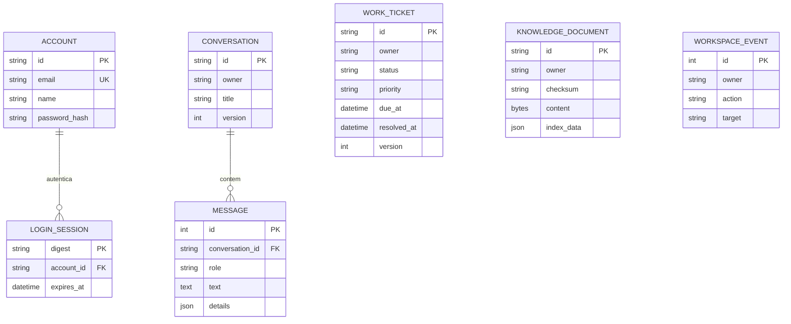

# GAI Assistant · Memorial técnico e roteiro

## Resumo

Uma operação de suporte usa documentos, sistemas e registros espalhados. O GAI Assistant concentra a busca por evidências, a triagem inicial e o acompanhamento do trabalho em uma aplicação web. A interface liga a resposta do assistente ao cadastro de chamados e mantém a decisão final no formulário revisado pelo operador.

**Pergunta de projeto** · Como reunir a documentação técnica e a triagem em um fluxo com fontes consultáveis, prazos verificáveis e dados separados por espaço de trabalho?

**Objetivo geral** · Implementar e validar um copiloto de TI que reduza os passos necessários para consultar procedimentos e registrar incidentes.

## Entregas demonstráveis

| Caso | Entrada | Resultado esperado |
| --- | --- | --- |
| Consultar procedimento | Pergunta sobre login do TOTVS | O assistente recupera o runbook e indica a página. |
| Fazer triagem | Descrição de incidente de acesso | Categoria, sistema, prioridade, justificativa e próxima ação. |
| Registrar e resolver | Revisão do operador | Chamado persistido, prazo calculado, atualização de situação e evento no painel. |
| Analisar planilha | Nome do agrupamento e métrica | O Pandas soma as vendas por vendedor. Felipe aparece com 1.230 na amostra. |
| Isolar dados | Entrada em outra conta ou sessão | Chamados, conversas e documentos pertencem ao espaço ativo. |
| Exportar evidências | Tabela de chamados ou conversa | CSV sanitizado ou Markdown com referências. |

## Modelo de dados

O campo `owner` recebe o ID da conta autenticada ou o identificador aleatório do navegador visitante. Visitantes usam UUID v4 e contas usam UUID v5. O backend rejeita um identificador de conta apresentado como sessão de visitante. Conversas antigas da primeira versão continuam com seus IDs originais. As tabelas novas são criadas de forma aditiva na inicialização.

## Decisões técnicas para defender

- **Serviços em uma API modular** · Separar conta, chamados, documentos e assistência por módulo facilita testes e reduz a quantidade de serviços que a turma precisa instalar.
- **Busca com evidência** · O PDF individual é dividido em trechos por página e usa ChromaDB em memória para recuperar candidatos com vetores locais de termos. Para o acervo, a indexação guarda trechos do PDF ou estatísticas das abas. A consulta combina coincidências no conteúdo, nome e descrição e preserva até cinco fontes distintas por página ou aba.
- **Cálculo no código e síntese no modelo** · Contagens, somas, rankings, prazos e indicadores são calculados na aplicação. O GPT recebe contexto limitado para explicar o resultado. Em busca web, a Tavily fornece o material e os links.
- **Confirmação humana** · A triagem preenche uma sugestão. O operador pode corrigir os campos antes de gravar. O prazo considera a prioridade e a data de abertura. Crítica tem 4 horas, alta 8, média 24 e baixa 72. Alterar a prioridade recalcula o alvo a partir da abertura.
- **Consistência** · Conversas gravam os dois turnos juntos. Chamados e eventos são gravados na mesma transação. O controle de versão detecta edição concorrente e retorna conflito para preservar a última gravação.
- **Controle de acesso** · A senha é derivada com scrypt e sal aleatório. Apenas o hash do token de sessão é persistido. O cookie é HTTP-only, tem prazo de sete dias e é revogado ao sair. A autenticação tem limite de tentativas por endereço e por processo.
- **Delimitação** · O protótipo trata arquivos com texto e planilhas tabulares. Voz, OCR, integrações corporativas autenticadas e execução de SQL fazem parte das possibilidades de continuidade.

## Plano acadêmico em quatro semestres

| Semestre | Frente | Evidência de entrega |
| --- | --- | --- |
| 1 | Levantamento do processo de suporte, modelagem e protótipo de chat | Mapa do fluxo, telas, contratos da API e histórico básico. |
| 2 | Pesquisa, interpretação de arquivos e respostas com contexto | Roteiro com PDF, Excel, perguntas de controle e citações. |
| 3 | Conta, central de chamados, prazos, biblioteca e indicadores | Fluxo integrado de incidente e isolamento de espaços. |
| 4 | Testes em dois bancos, empacotamento, documentação e banca | Pipeline automatizado, dados reproduzíveis e apresentação. |

Este quadro organiza as etapas de um projeto de dois anos. As entregas da versão atual podem ser verificadas no código e na suíte.

## Roteiro de apresentação · 9 minutos

| Tempo | Ação |
| --- | --- |
| 0:00–1:00 | Apresente o problema e a pergunta de projeto. Mostre o ciclo “consultar → classificar → registrar → acompanhar”. |
| 1:00–2:10 | Explique os módulos e por que cálculos e prazos ficam na aplicação. |
| 2:10–3:30 | Abra a visão geral, carregue os dados fictícios e mostre os quatro indicadores. |
| 3:30–4:45 | Consulte “Qual é o procedimento para falha de login no TOTVS?”. Abra a referência do PDF. |
| 4:45–6:30 | Selecione **Triagem de TI** e envie “TOTVS está retornando erro de login para toda a equipe financeira”. Clique em **Criar chamado**, revise e salve. |
| 6:30–7:30 | Marque o chamado como **Resolvido**, exporte o CSV e retorne ao painel para mostrar a atividade. |
| 7:30–8:15 | Abra **Vendas por equipe.xlsx** e execute o exemplo de ranking. Mostre que o valor é calculado sobre todas as linhas da amostra. |
| 8:15–9:00 | Resuma os testes executados, a separação por espaço e os próximos passos de pesquisa. |

### Preparação

Faça uma execução de ensaio com Docker ou em desenvolvimento. Confira `/api/health` e abra o PDF dos slides. Para uma demonstração com dados iniciais limpos, use uma nova janela privada ou uma conta de ensaio. A apresentação completa funciona com os serviços externos desativados.

### Perguntas prováveis da banca

- **Como avaliaria a qualidade da IA?** Monte um conjunto de casos revisados. Compare a categoria sugerida com a anotação humana, meça a concordância e registre erros por categoria. Para recuperação, verifique se as páginas relevantes aparecem nas primeiras posições.
- **Como evitar que planilhas sejam “respondidas por aproximação”?** O servidor calcula a agregação com Pandas. A resposta identifica a aba, a métrica e a regra de agrupamento usada.
- **Por que armazenar documentos no banco?** Para facilitar o isolamento, a recuperação e o backup neste tamanho de projeto. Se o acervo crescer, anexe armazenamento de objetos e migre o índice para um serviço persistente.
- **Como mostraria tolerância a falhas?** Desative os provedores, use a demonstração local e apresente o teste de exportação, os conflitos de versão e os erros de acesso de outro espaço.
- **Que resultados já foram medidos?** A suíte mede comportamento em cenários definidos. Taxa de acerto humano, redução de tempo de atendimento e desempenho em produção exigem um estudo com dados reais.

## Verificação reproduzível

A suíte verifica contexto de conversa, isolamento por sessão e conta, login e revogação, limitação de tentativas, fontes e download do acervo, upload inválido, deduplicação, ranking Excel, SQL, código, classificação estruturada e a exigência de confirmação antes de salvar. Também verifica prazos, conflito de edição, trilha de atividade, carga idempotente de dados, proteção de CSV e a integração com as APIs simuladas. Consulte os comandos no [README](../README.md#desenvolvimento-e-testes).
